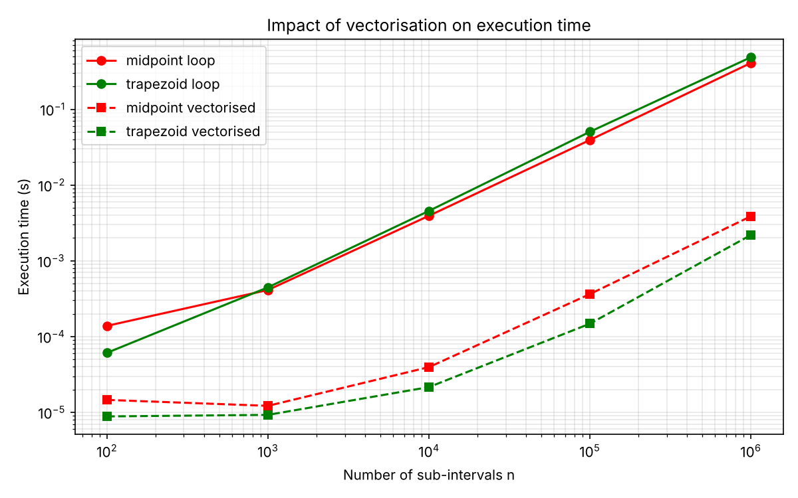
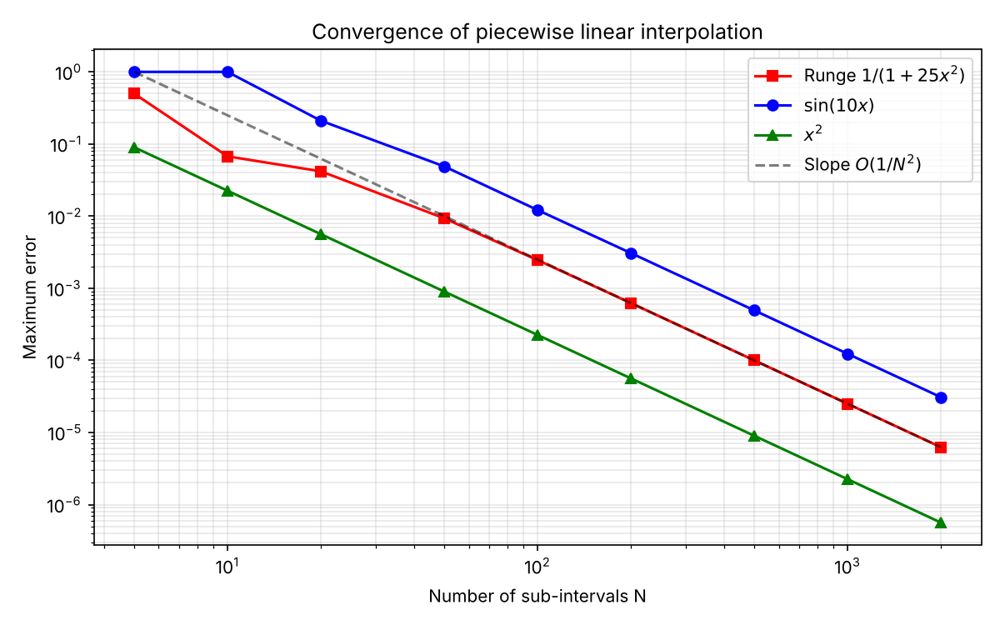
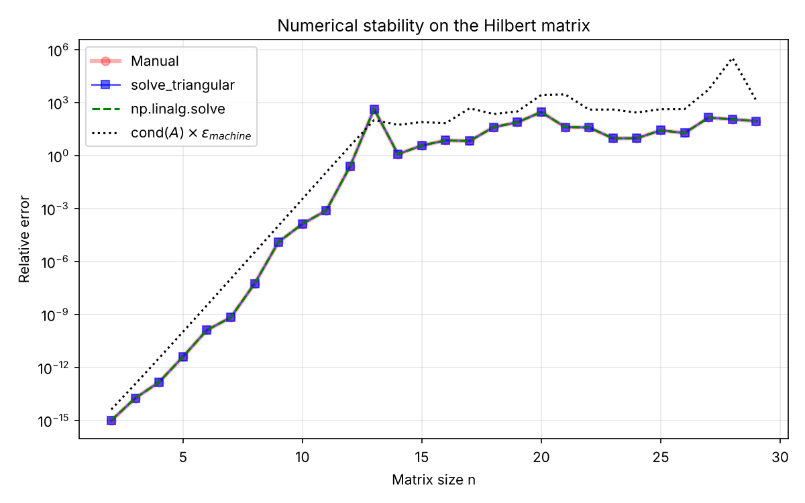
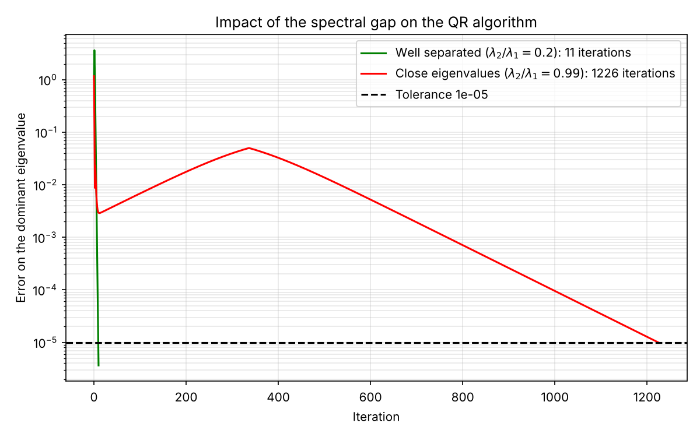

# Numerical methods from scratch: accuracy, convergence and performance

Classic numerical methods implemented by hand in Python, then benchmarked against NumPy and SciPy. For each method, I measure **how fast it converges**, **how stable it is**, and **how fast it runs**.

This is my part of a scientific computing project carried out in pairs at **ENS Paris-Saclay** (January 2026), which ended with an oral presentation graded 20/20.

## Contents

| Topic | What is implemented | What is studied |
|---|---|---|
| Numerical integration | Composite midpoint and trapezoidal rules, in a loop version and a vectorised version | Speed-up from vectorisation, $O(1/n^2)$ convergence |
| Interpolation | Piecewise linear interpolation | $O(1/N^2)$ convergence, including on the Runge function |
| Linear systems | Solving $Ax = b$ by QR decomposition and back substitution | Speed of three triangular solvers, stability on ill-conditioned matrices |
| Eigenvalues | Gram–Schmidt QR decomposition and the (unshifted) QR algorithm | Effect of the spectral gap on convergence speed |

## Key results

### Vectorisation speeds up integration about 100-fold
Replacing Python `for` loops with NumPy array operations makes the midpoint rule about **100× faster** and the trapezoidal rule about **200× faster** for $n = 10^6$ sub-intervals.



### Piecewise linear interpolation converges in $O(1/N^2)$
The fitted slope of the maximum error is **−2.00** for every test function. That includes the Runge function, for which global polynomial (Lagrange) interpolation on equally spaced nodes diverges. The price of this stability is that the interpolant is not differentiable at the nodes.



### Ill-conditioning limits the accuracy of every solver
On the Hilbert matrix, the relative error follows the condition number times machine precision, whichever triangular solver is used. Above $n \approx 12$, the solution loses all its significant digits. QR is a stable method, but it cannot overcome ill-conditioning.



### The spectral gap drives the convergence of the QR algorithm
With well-separated eigenvalues ($\lambda_2/\lambda_1 = 0.2$), the dominant eigenvalue reaches an error of $10^{-5}$ in **11 iterations**. With close eigenvalues ($\lambda_2/\lambda_1 = 0.99$), it takes **over 1,200 iterations**. This is why practical implementations such as LAPACK use shifts.



Exact numbers vary slightly between machines.

## Repository structure

```
numerical_methods/     the methods themselves
  quadrature.py        midpoint and trapezoidal rules
  interpolation.py     piecewise linear interpolation
  linear_systems.py    QR solve and back substitution
  eigenvalues.py       Gram-Schmidt QR and the QR algorithm
experiments/           one script per study, each saves its figures
figures/               generated figures
```

## Run it

```bash
pip install -r requirements.txt
python experiments/run_quadrature.py
python experiments/run_interpolation.py
python experiments/run_linear_systems.py
python experiments/run_eigenvalues.py
```

## Author

Shyrine Sallam, ENS Paris-Saclay. Project carried out with Gabin Michelot, who worked on Lagrange and Chebyshev interpolation, the power method, LU decomposition, the conjugate gradient and Simpson's rule; that code is not included here.
